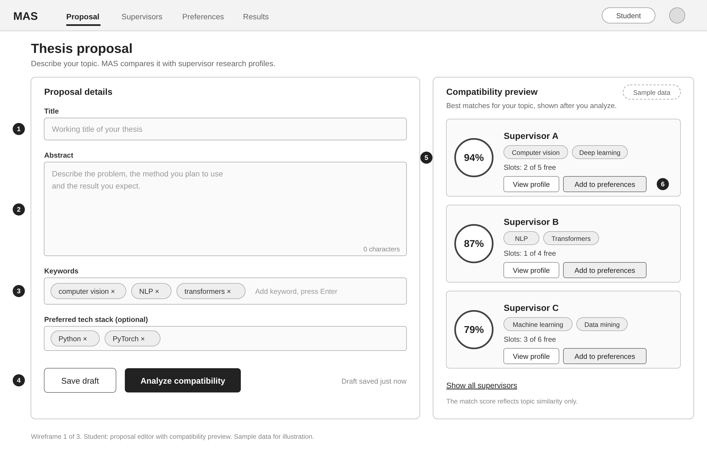
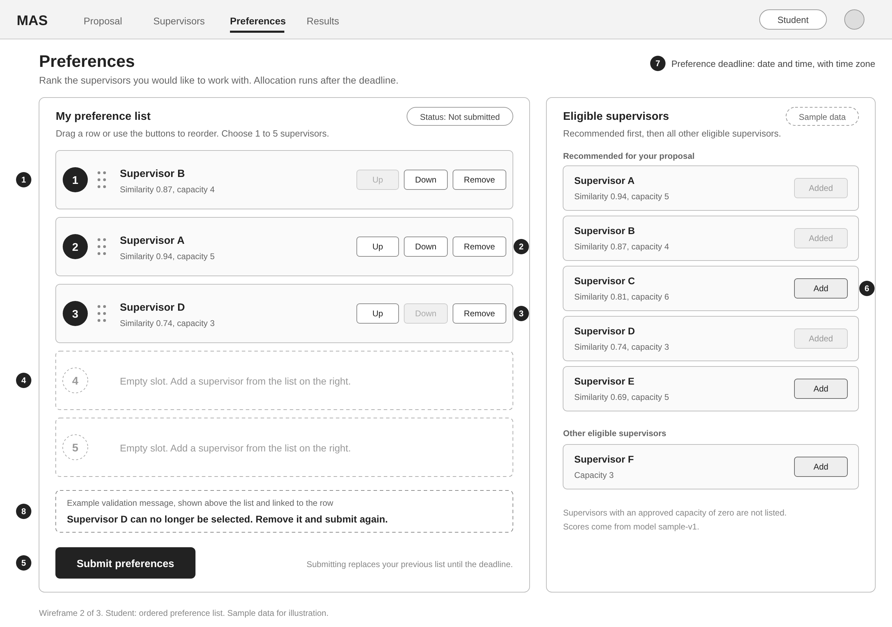
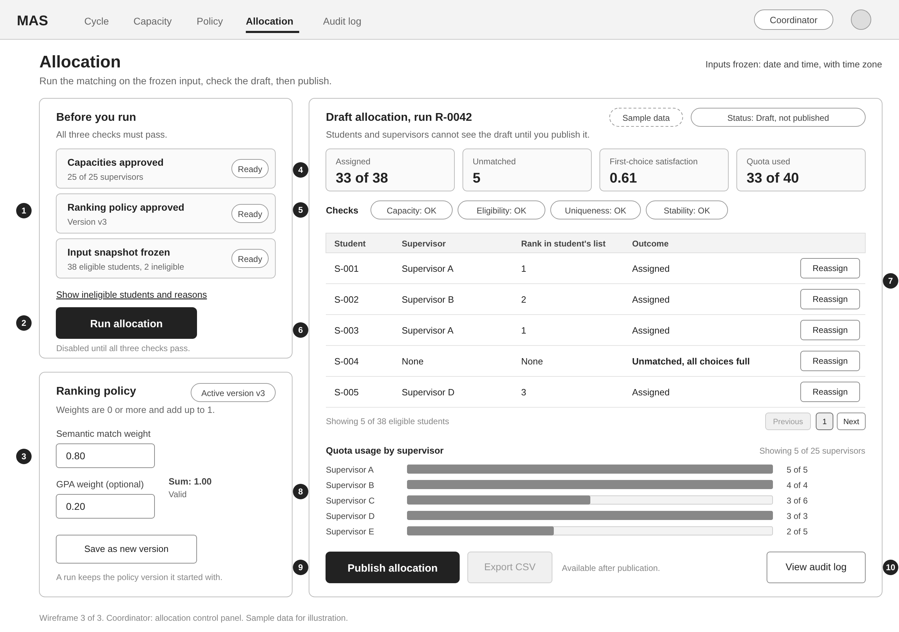

# UX wireframes and prototype specifications

Low-fidelity wireframes for the three key screens of MAS: the student proposal editor, the preference builder and the coordinator panel. Each screen has a wireframe and a short specification of its elements, states and the data it needs from the API.

The wireframes follow the requirements in [`docs/06-requirements-spec.md`](../docs/06-requirements-spec.md). Requirement IDs such as FR-05 or AC-F02 refer to that document.

The SVG files are the editable sources. The PNG files are exports at 2x size.

## Status

| # | Screen | Role | Wireframe | Status |
|---|---|---|---|---|
| 1 | Proposal editor with recommendations | Student | [SVG](wireframes/01-student-proposal.svg), [PNG](wireframes/01-student-proposal.png) | Done |
| 2 | Preference list (ordered) | Student | [SVG](wireframes/02-student-preferences.svg), [PNG](wireframes/02-student-preferences.png) | Done |
| 3 | Allocation control panel | Coordinator | [SVG](wireframes/03-coordinator-allocation.svg), [PNG](wireframes/03-coordinator-allocation.png) | Done |

The REST API request and response examples are in [api-contracts.md](api-contracts.md). They are a draft for the backend to review. The interactive prototype is in [Figma](https://www.figma.com/design/9CgkSjXyeDTuWuDcsW6W8A), described in the last section.

## Screen 1: proposal editor with recommendations

A student writes the thesis proposal on the left. After submitting it, the right side lists up to five supervisors whose research profiles are most similar to the proposal text.

### Elements

| # | Element | Behavior |
|---|---|---|
| 1 | Title | Single-line text field, 5 to 200 characters (FR-02, AC-F02). |
| 2 | Abstract | Multi-line text field, 100 to 5,000 characters, with a live counter. This text is the main input for the similarity score. |
| 3 | Keywords | Tag input for 1 to 10 non-empty keywords. Enter adds a keyword, the cross removes it. |
| 4 | Save draft and Submit proposal | Save draft stores the fields without submitting. Submit proposal checks all fields, then submits the one proposal allowed per cycle. |
| 5 | Similarity score | A number from 0 to 1 in a circular badge, in descending order down the list (FR-05, AC-F05). The panel carries the line "A similarity score is not a probability of acceptance." and names the model version. |
| 6 | Add to my list | Adds the supervisor to the student's ordered preference list of one to five supervisors (FR-06). The list is edited on screen 2. |
| 7 | Deadline | Submission deadline with its time zone, taken from the cycle settings (FR-04). The server clock decides whether the deadline has passed. |
| 8 | Validation message | Plain text next to the field and linked to it. The last valid proposal stays saved (AC-F02, NFR-04). |

Each recommendation card shows the supervisor's name, research areas and approved capacity. Capacity is the figure the coordinator approved for the cycle (FR-03). Allocation runs as one batch after the deadline, so the screen has no live count of free places.

The link Show all eligible supervisors under the cards opens the full list on screen 2. FR-06 lets a student rank any eligible supervisor, including ones outside the five recommendations.

The supervisor names, scores, capacities and the model name in the wireframe are sample data.

### States to design

- **Draft:** as drawn. The form is editable and the right panel shows a hint to submit the proposal.
- **Loading:** the submit button is disabled and the panel shows placeholders.
- **Recommendations:** up to five cards in descending order of score.
- **Fewer than five eligible supervisors:** all eligible supervisors are shown (AC-F05).
- **No eligible supervisors:** an explicit message instead of cards.
- **Service error:** a retryable message. No recommendations are made up and the submitted preferences stay unchanged (AC-F05).
- **Closed:** the deadline has passed or the inputs are frozen. The form is read-only and shows the last accepted proposal with its submission time (AC-F02).

### Accessibility

Every field has a visible label. Errors appear as text linked to the field, focus stays visible, and a keyboard-only user can complete the form and add supervisors to the list (NFR-04, AC-N04).

### Data the screen needs

- The proposal: title, abstract, keywords, status and submission time.
- The cycle: deadline with time zone, and whether inputs are frozen.
- For each recommended supervisor: id, name, research areas, approved capacity, similarity score, rank and the model version.

### Open questions

- The project overview lists a preferred tech stack as a proposal field. FR-02 has only title, abstract and keywords, so the wireframe leaves the tech stack out until the requirements decide.
- FR-05 ties recommendations to a submitted proposal. Whether a student may preview recommendations for a draft needs a decision.
- It is open whether a student can edit and resubmit after seeing the recommendations, and whether the list then refreshes.
- The content of the View profile page is not defined yet.

## Screen 2: preference list

A student orders one to five supervisors. The list on the left is the one that gets submitted. The list on the right shows every eligible supervisor, with the recommended ones first.

### Elements

| # | Element | Behavior |
|---|---|---|
| 1 | Rank badge and drag handle | The badge shows the position in the list. Dragging a row changes the order. The submitted order is the student's ranking (FR-06). |
| 2 | Up and Down | Move a row by one place. They give a keyboard and pointer alternative to dragging (NFR-04). Up is disabled on the first row and Down on the last. |
| 3 | Remove | Takes the supervisor out of the list and frees the slot. |
| 4 | Empty slot | A free position. The list has five positions in total. |
| 5 | Submit preferences | Checks the whole list and replaces the previous one. A valid list has one to five distinct eligible supervisors. An invalid list is rejected as a whole (AC-F06). |
| 6 | Add | Puts the supervisor in the first free slot. The button reads Added for supervisors already in the list, and every Add button is disabled when five are chosen. |
| 7 | Deadline | Preference deadline with its time zone, taken from the cycle settings (FR-04). The server clock decides. |
| 8 | Validation message | Plain text above the list and linked to the row it concerns. It covers an empty list, a duplicate, more than five entries and an ineligible supervisor. The last accepted list stays unchanged. |

The right-hand list starts with the supervisors recommended for the student's proposal (FR-05), followed by the other eligible supervisors. A supervisor with an approved capacity of zero is not listed (AC-F03). The supervisor names, scores and capacities in the wireframe are sample data.

### States to design

- **No supervisor chosen:** all five slots are empty and Submit preferences is disabled with a short hint.
- **Unsubmitted changes:** the status chip reads Not submitted and the list differs from the last accepted one.
- **Submitted:** the status chip shows the submission time.
- **Full list:** five supervisors are chosen and every Add button is disabled with a hint to remove one first.
- **Rejected:** the validation message is shown and the last accepted list is kept (AC-F06).
- **Closed:** the deadline has passed or the inputs are frozen. The list is read-only and shows the accepted order (AC-F06).
- **No proposal submitted yet:** the right-hand list shows eligible supervisors without scores and suggests submitting the proposal first.

### Data the screen needs

- The student's accepted list: ordered supervisor ids and the submission time.
- The eligible supervisors: id, name, approved capacity, and the similarity score for the recommended ones.
- The cycle: preference deadline with time zone, and whether inputs are frozen.

### Open questions

- FR-06 speaks of submitting a list. Whether a student can save an unsubmitted draft of the list is open. The wireframe treats every submission as a replacement.
- Whether Add to my list on screen 1 changes the submitted list at once or only the draft shown on this screen.
- FR-05 returns scores for up to five supervisors. Whether scores are shown for the other eligible supervisors needs a decision. The wireframe shows capacity only.

## Screen 3: coordinator allocation panel

The coordinator checks that a run can start, starts it, reviews the draft and publishes it. The left column holds the run conditions and the ranking policy. The right column holds the draft and the publication controls.

### Elements

| # | Element | Behavior |
|---|---|---|
| 1 | Readiness checks | Three conditions for a run: capacities approved (FR-03), ranking policy approved (FR-07) and input snapshot frozen (FR-04). Each card shows its state. A link opens the ineligible students with a reason for each (AC-F04). |
| 2 | Run allocation | Starts the batch matching on the frozen snapshot (FR-08). Disabled until the three checks pass. Repeated requests for the same run create no duplicate assignments, and a failed run shows a failed status without a partial result (AC-F08). |
| 3 | Ranking policy | Two weights, semantic match and optional GPA, each 0 or more and adding up to 1 within 0.000001. Save as new version creates a new immutable version, and a run keeps the version it started with. If GPA has a positive weight and a record has no GPA, the run is blocked and the affected records are named (AC-F07). |
| 4 | Summary figures | Assigned, unmatched, first-choice satisfaction and quota used for the draft (FR-09). Satisfaction counts eligible unmatched students in the denominator and shows N/A when the denominator is empty (AC-F09). |
| 5 | Validation checks | Capacity, eligibility, uniqueness and stability results for the draft (AC-F09). A failed check, or one that has not completed, blocks publication (AC-F10). |
| 6 | Assignment table | Every eligible student with the assigned supervisor, the position of that supervisor in the student's list, and the outcome. Unmatched students stay in the table with an explicit outcome (AC-F08, AC-F09). |
| 7 | Reassign | Opens a form with the new supervisor and a required reason. The result is a revised draft that gets new eligibility, capacity, uniqueness and stability checks. Publishing it needs explicit coordinator review and zero blocking pairs against the same frozen rankings, and a recorded reason does not waive a failed check (FR-13, a Should requirement). |
| 8 | Quota usage | Assigned count against approved capacity for each supervisor (FR-09). |
| 9 | Publish allocation | Publishes the validated draft in one step and records the coordinator, time and run ID (FR-10, AC-F10). Disabled while a check has failed or has not completed. Publishing the same version again changes nothing. |
| 10 | Export CSV and View audit log | The export has one row per enrolled student with the supervisor or an empty value, the outcome or reason, the cycle ID and the run ID (FR-11, AC-F11). It stays disabled until a result is published. The audit log lists events with actor, action, time, entity and version or run ID (FR-12, AC-F12). |

Cycle creation, enrollment, the deadline and the approval of capacities (FR-03, FR-04) have their own views, which are not drawn here. The student identifiers, supervisor names, counts and the run number in the wireframe are sample data.

### States to design

- **Not ready:** at least one check is missing. The card says what is missing and links to the place where it is fixed. Run allocation is disabled.
- **Running:** Run allocation is disabled and the status chip reads Running.
- **Failed:** the status chip reads Failed with the reason. No partial result is shown and Run allocation becomes available again (AC-F08).
- **Draft ready:** as drawn.
- **Validation failed or incomplete:** the failed check shows its reason and the affected students, and a check that has not run is marked as missing. Publish allocation is disabled in both cases (AC-F10).
- **Revised draft:** after a manual reassignment the panel shows a banner that review is required and repeats the checks (FR-13).
- **Published:** the status chip shows the publication time, version and run ID. Publish allocation is disabled and Export CSV is enabled (AC-F10, AC-F11).
- **No eligible students:** first-choice satisfaction shows N/A (AC-F09).
- **Other roles:** students and supervisors never see this screen or the draft, and direct API requests for it are rejected (FR-01, AC-F09).

### Accessibility

Every control has a visible label. Check results and statuses are written out as text. The quota bars carry their numbers as text and the table has column headers, so keyboard and screen reader users get the same information (NFR-04, AC-N04).

### Data the screen needs

- The cycle: id, status and the snapshot time with time zone.
- Readiness: number of approved capacities, the approved policy version, snapshot counts and the list of ineligible students with reasons.
- The active policy: version, semantic weight and GPA weight.
- The run: id, status, policy version, model version and snapshot id.
- The draft: summary figures, validation results, one row per eligible student (student id, supervisor id, rank in the student's list, outcome or reason) and quota usage for each supervisor.
- The publication: version, time and coordinator.

### Open questions

- AC-F04 requires an approved ranking policy and approved capacities. Whether saving a policy version also approves it, or approval is a separate step, is not defined.
- AC-F04 says a frozen snapshot is never modified, changed inputs need a new snapshot identifier, and earlier snapshots stay available for replay and audit. The wireframe shows only the current snapshot. Where the coordinator creates a new snapshot and chooses one for a run is open: this panel or the cycle view.
- FR-13 requires explicit coordinator review and zero blocking pairs for a revised draft. It does not say what the review looks like or how a blocking pair is shown. The wireframe uses a form with a reason and leaves the confirmation step open. The API draft proposes a `reviewed` flag on publish.
- The wireframe shows anonymous student IDs. Whether coordinators see names and GPA in this table depends on the privacy policy (NFR-01).
- FR-14 (Should) wants notification delivery failures shown to the coordinator. The panel has no place for them yet.

## Figma prototype

[MAS UX prototype](https://www.figma.com/design/9CgkSjXyeDTuWuDcsW6W8A) holds the three screens as editable vector layers, imported from the SVG files in this folder. Two flows are set as starting points for Presentation view:

- **Student: proposal and preferences.** On screen 1, Add to my list, Show all eligible supervisors and the Preferences tab open screen 2. The Proposal tab on screen 2 goes back to screen 1.
- **Coordinator: allocation panel.** Screen 3 has no clicks. Its states are described in the section above.

The SVG files in this folder stay the source. The Figma file was imported from them, so edits made in Figma are not copied back, and a changed screen has to be imported into Figma again. The file needs view access for the committee: Share, then anyone with the link can view.
